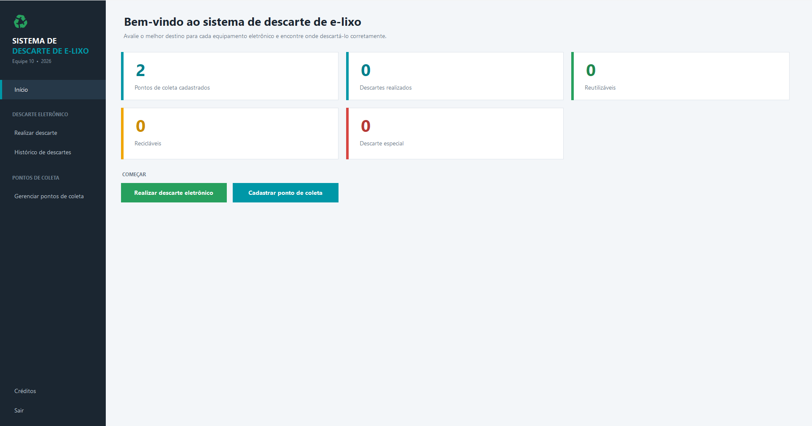
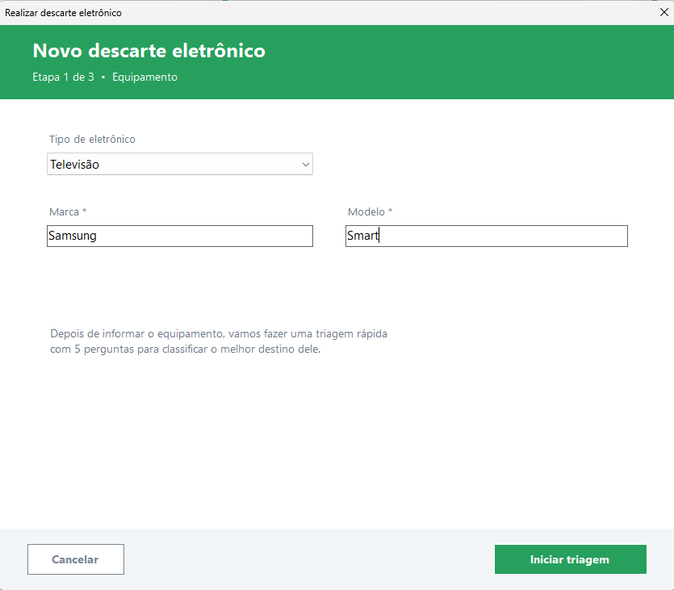
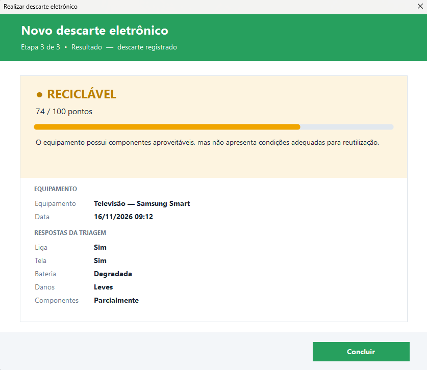
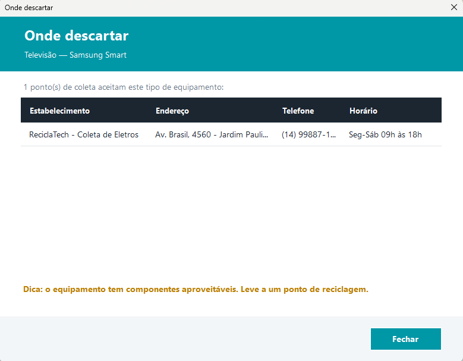
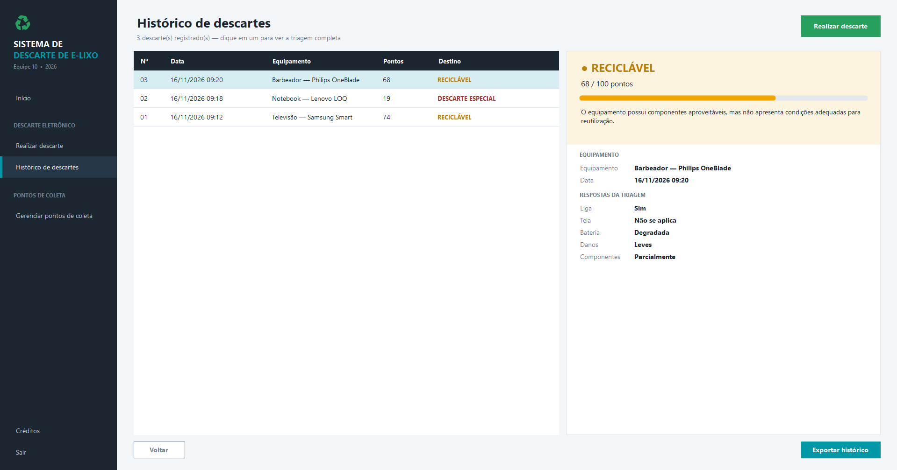
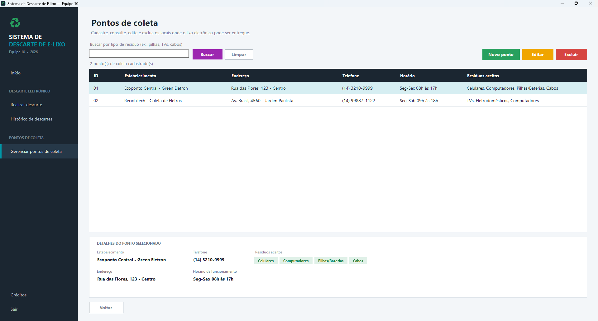
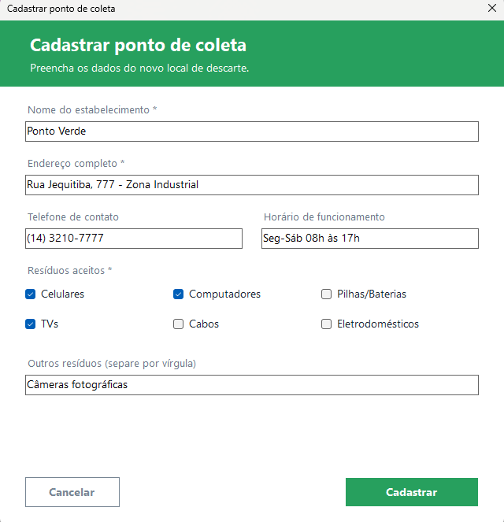

# Sistema de Descarte de E-lixo

Aplicação desktop para Windows que ajuda a dar o destino correto ao lixo eletrônico. A pessoa responde cinco perguntas sobre o aparelho, recebe uma pontuação de 0 a 100 com a classificação **reutilizável**, **reciclável** ou **descarte especial**, e vê quais pontos de coleta aceitam aquele equipamento.

Projeto desenvolvido na disciplina **Programação de Computadores** do curso de Ciência da Computação do **UNISAGRADO**, no 2º semestre de 2026.



## Funcionalidades

- **Triagem do equipamento** em três etapas: dados do aparelho, cinco perguntas e resultado
- **Pontuação e classificação** do aparelho (reutilizável, reciclável ou descarte especial)
- **Onde descartar:** ao final da triagem, mostra os pontos de coleta que aceitam o equipamento
- **Pontos de coleta:** cadastro, edição, exclusão e busca por tipo de resíduo
- **Histórico de descartes** com os detalhes de cada triagem e exportação para planilha (CSV)
- **Dados salvos automaticamente** em um arquivo local, sem banco de dados e sem internet

## Capturas de tela

| Triagem | Resultado |
|---|---|
|  |  |
| **Onde descartar** | **Histórico** |
|  |  |
| **Pontos de coleta** | **Cadastro de ponto** |
|  |  |

## Como funciona a pontuação

Cada pergunta tem um peso, e os pesos somam 100:

| Pergunta | Peso | Resposta intermediária |
|---|---|---|
| O aparelho liga? | 30 | — |
| Os componentes internos estão funcionais? | 25 | Parcialmente: 12 |
| A tela funciona? | 20 | — |
| A bateria está funcionando? | 15 | Degradada: 7 |
| Possui danos físicos? | 10 | Leves: 5 |

Quando a resposta é **"Não se aplica"** (por exemplo, a tela de um mouse), aquele critério sai da conta e a nota é proporcional ao que vale para o aparelho:

```
nota = pontos obtidos ÷ pontos possíveis × 100
```

| Pontuação | Classificação |
|---|---|
| 80 a 100 | Reutilizável |
| 40 a 79 | Reciclável |
| 0 a 39 | Descarte especial |

## Download e instalação

Na página de **[Releases](../../releases)** estão:

- `Instalador_SistemaDescarteEletronico_1.0.0.exe`: instalador para Windows
- `SistemaDescarteEletronico_1.0.0_portatil.zip`: versão que roda sem instalar (extraia a pasta e abra o `.exe`)

**Requisitos:** Windows 10 (20H2 ou mais novo) ou Windows 11, 64 bits, com o .NET Framework 4.8.1. O Windows 11 já vem com ele; no Windows 10, se precisar, baixe em <https://dotnet.microsoft.com/pt-br/download/dotnet-framework/net481>.

> Como o executável não tem assinatura digital, o Windows pode mostrar "O Windows protegeu o computador". Clique em **Mais informações** e depois em **Executar assim mesmo**.

## Como compilar o código

1. Instale o **Visual Studio** com a carga de trabalho **Desenvolvimento para desktop com .NET** e o pacote de destino do **.NET Framework 4.8.1**.
2. Clone o repositório e abra `SistemaDescarteEletronico.sln`.
3. Aperte **F5** para compilar e executar.

Para gerar o instalador, compile em **Release** e abra `Instalador/SistemaDescarteEletronico.iss` no [Inno Setup](https://jrsoftware.org/isinfo.php).

## Tecnologias

- C# com Windows Forms
- .NET Framework 4.8.1
- JSON (`DataContractJsonSerializer`) para salvar os dados
- Inno Setup para o instalador

Nenhuma biblioteca externa é usada.

## Estrutura do código

```
SistemaDescarteEletronico/
├─ Program.cs     ponto de entrada
├─ Models/        classes de dados e enums
├─ Services/      regras: pontuação, perguntas, sugestão de pontos, exportação
├─ Data/          listas em memória e gravação do arquivo JSON
└─ Ui/            telas (Forms e painéis) e controles próprios
Instalador/       script do Inno Setup
```

Os dados ficam em `%AppData%\SistemaDescarteEletronico\dados.json`. Na primeira execução o arquivo é criado com dois pontos de coleta de exemplo.
